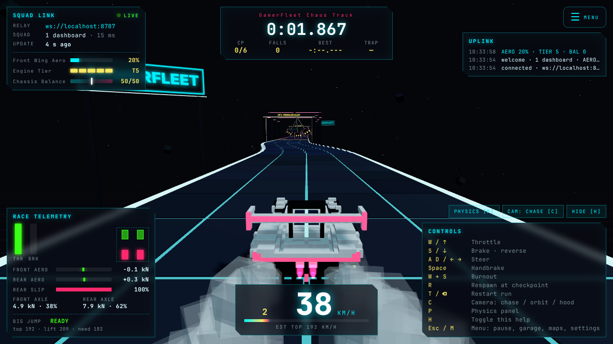
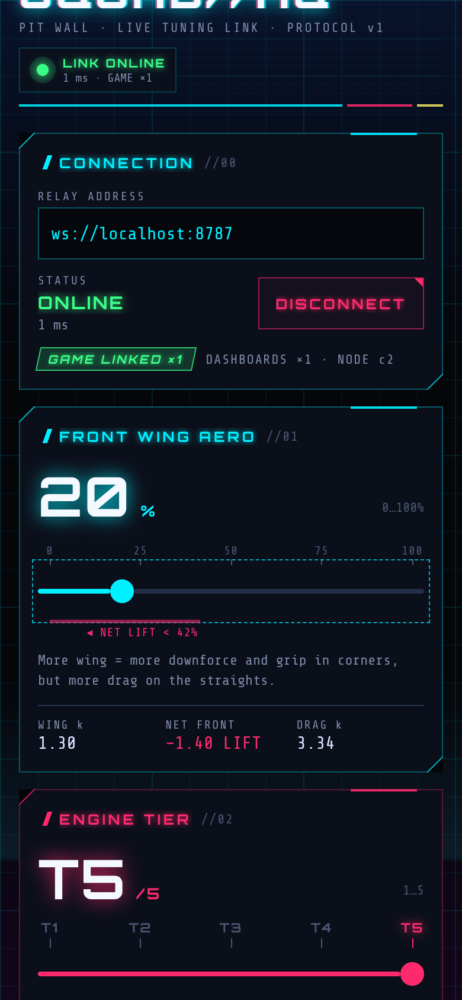

# SquadHQ Racer

A voxel racing game you tune live from your phone.

<p>
  
  
</p>

## Play online

**https://anayechouksey4-sudo.github.io/anaye-game/**

GitHub Pages serves the game from the [`docs/`](docs/) folder. One-time setup in the repository: Settings → Pages → Build and deployment → Source **Deploy from a branch** → Branch `main`, folder **/docs** (or **/ (root)**: the root `index.html` forwards to `docs/`) → Save, then wait a minute or two. The hosted copy plays offline (an https page can't reach a plain `ws://` relay), so tune the car with ☰ MENU → PHYSICS; `?ws=wss://…` still connects a relay that has TLS. Install it as an app from the browser menu (or ☰ MENU → SETTINGS → APP → INSTALL APP) and it plays offline afterwards. After a game change, rebuild it with `node scripts/build-pages.mjs` and commit `docs/`.

| Folder | What it is | Stack |
| --- | --- | --- |
| [`game/`](game/README.md) | 3D racer: nine voxel cars, six track maps (the **GamerFleet Chaos Track** over a bottomless void first) and **Tessera Isle**, an open-world island with free roam and four races; race-car aero and drivetrain physics | Vite, React Three Fiber, @react-three/rapier |
| [`dashboard/`](dashboard/README.md) | Cyberpunk control panel with **Front Wing Aero**, **Engine Tier** and **Chassis Balance** sliders, big-jump readiness and live telemetry | Expo, React Native |
| [`server/`](server/README.md) | Local WebSocket relay on port 8787 that connects the two | Node, ws |
| [`shared/protocol.ts`](shared/protocol.ts) | Wire protocol and the slider → physics mapping used by all three | TypeScript, no dependencies |
| [`scripts/dev-all.mjs`](scripts/dev-all.mjs) | One-command launcher (installs, starts everything, prints the URLs) | Node, concurrently |

- **Cars:** nine original voxel classes in the ☰ GARAGE (Neon Hypercar, Glitch Rally, Bruiser V8, Razorwing, Dune Goblin, Ember Swallowtail — the red rear-engined coupe with plate `UK 07 DW 2400` — Smoke Lantern, Ion Dragonfly, Pixel Gnat), each with its own rear number plate you can retype; five **DRIVERS** (Anaye owns the garage) built from blocks who sit in every car; and **MY RIDE**, a build-your-own look over any class (paint, neon trim, wheels, spoiler, exhaust tips, stance, name, plate) that drives exactly like its base car. Details in [`game/README.md`](game/README.md).
- **Rivals and your ghost:** every timed race starts with three rivals driving at that car's gold, silver and bronze pace (beat the gold rival and you are P1); the top bar shows your live position (`P2/4`, tap it for the standings), the results card your finishing position and gap, and your best run on each map comes back as a translucent shadow ghost. ☰ MENU → SETTINGS → RACE: 3 / 1 / no rivals, ghost on or off, skid marks on or off (dark tyre marks where the car slides, fading after 20 s).
- **Controls that fit the device:** keyboard on a PC, thumb controls on a phone, **tilt steering** (☰ MENU → SETTINGS → CONTROLS → TILT, with CALIBRATE and a range of 14–35°), and any standard gamepad the moment it is connected (stick steer, triggers, A handbrake, B respawn, Y restart, Start menu). The ☰ menu has ten tabs: RACE, CAREER, GARAGE, DRIVERS, MY RIDE, MAPS, PHYSICS, SETTINGS, SQUAD and FRIENDS.
- **Career:** the ☰ CAREER tab keeps your trophies (24 to find, from FIRST LIGHTS to GRID KING, PACK LEADER and BIG AIR), your medal matrix of every map × every car, podiums against the rivals, friends races won, kilometres driven, top speed, longest leap and time played. A trophy unlock shows a short notice under the top bar. RESET CAREER needs two taps. Everything is stored on the device only.

## Play with friends

Rooms run over the same relay the dashboard uses: everyone drives their own car on their own phone, the others
appear as pass-through cars (no collisions), the host picks the map and starts the race, and the lights go out for
everyone at the same moment on the relay's clock.

**Same Wi-Fi or hotspot, in three steps:** (1) on one computer or phone run `npm run dev:all` and read the
`http://<ip>:5173` line it prints; (2) everyone opens that link; (3) one player taps ☰ MENU → **FRIENDS** →
**HOST A ROOM** and reads out the 4-letter code (or taps COPY and sends the link); the others JOIN with the code,
tap READY, and the host taps START. Results (position, time, gap) land in the FRIENDS tab and on the results card.

**Private rooms:** pick the ROOM SIZE before HOST A ROOM (2 = you + 1 friend, up to 8; the host can raise or lower it
in the lobby) and nobody else gets in (`ROOM FULL (2/2)`). Rooms are humans only: the AI rivals and your shadow
ghost are off while you are in a room (solo races keep SETTINGS · RIVALS / GHOST). The host stays the host even if
their phone drops the connection for a while (sharing the link on a chat app, a network switch, or the browser
reloading the page after it was in the background): the seat is kept for 2 minutes and the game takes it back on
its own when it is back within that time, and a friend who reconnects never shows up twice. A seat that is
RECONNECTING… still counts toward the size; a friend who opens the link again in another browser is told so, and
the host can REMOVE the old seat. Only the
host starts races, picks the map, changes the size, REMOVEs a player (they cannot come back into that room) or
hands the room over (MAKE HOST, or LEAVE, which asks who gets it). Set YOUR NAME in FRIENDS so two phones with the
default driver do not both say "Anaye" (the relay adds "2" if they still match).

**Over the internet:** host the relay once ([`server/README.md`](server/README.md#host-the-relay-online):
`render.yaml` + `server/Dockerfile`, free tier), then open the public game link with
`?ws=wss://<your-relay>`; the room link the host copies carries `ws=` and `room=` for the friends.

The public copy and the app installed from it connect to the owner's relay on their own (the `DEFAULT_RELAY` line at the top of `scripts/build-pages.mjs`; empty means offline by default), so ☰ MENU → FRIENDS opens straight on HOST A ROOM. A relay named in a friend's room link, or typed into FRIENDS → CONNECT, is remembered on that device instead; FORGET RELAY in the same tab switches that device to offline play until you connect again.

## Run everything with one command

Needs Node 22 or newer.

```bash
npm run dev:all
```

This one command:

1. Installs dependencies for the root, `server/` and `game/`, one package at a time. On later runs it skips any package whose `package.json` and lockfile haven't changed. If the `server/` or `game/` install fails, that service is skipped and the others still start. Only a failed root install stops the launcher.
2. Starts the relay, the game and the dashboard together in this terminal. Each service's log lines are prefixed with its name. If the dashboard needs an install (by far the biggest), it runs inside the dashboard's own process, so the relay and game don't wait for it. A failed dashboard install is retried twice, then the dashboard is skipped and the rest keep running.
3. Prints a summary as soon as the relay and the game answer. It doesn't wait for a dashboard that is still installing; on a laptop it gives one that is already starting up to 10 more seconds, on a phone none:

```
────────────────────────────────────────────────────────────────────────
 SQUADHQ // ALL SYSTEMS LIVE
   RELAY      ws://localhost:8787          ws://192.168.1.23:8787
   GAME       http://localhost:5173        http://192.168.1.23:5173
   DASHBOARD  exp://192.168.1.23:8081      web: http://localhost:8081

 Game + dashboard connect to the relay on port 8787 of whichever host served them.
 Dashboard on a phone: Expo Go → "Enter URL manually" → exp://192.168.1.23:8081
 Ctrl+C stops everything.
────────────────────────────────────────────────────────────────────────
```

If the dashboard is still installing or starting at that point, its row says so, and one more line with its URLs follows when it answers.

Press Ctrl+C to stop all three services. Closing the terminal (or the Termux session) or `pkill -f dev-all` stops them too. If the launcher itself was killed (for example by Android's low-memory killer) and left a service holding its port, free the ports with `fuser -k 8787/tcp 5173/tcp 8081/tcp` (`pkg install psmisc` on Termux if `fuser` is missing). If Android kills an install partway, the launcher says so and starts the rest; run `node scripts/dev-all.mjs --fresh` later to repair that package.

| Command | Does |
| --- | --- |
| `npm run dev:all` (or `npm start`) | Install what's missing, then run all three |
| `npm run start:all` | Run all three without the install check |
| `npm run setup` | Install only |
| `node scripts/dev-all.mjs --fresh` | Delete `node_modules` and reinstall every package from scratch (repairs an interrupted install) |
| `node scripts/dev-all.mjs --only=relay,game` | Run only some services |
| `npm run dev:relay` / `dev:game` / `dev:dashboard` | Run one service on its own |
| `npm test`, `npm run typecheck`, `npm run build` | Relay, dashboard and island-generator tests (the last is skipped where the dashboard is not installed), typecheck all three, production build of the game |

### On an Android phone (Termux)

```bash
pkg update && pkg install nodejs-lts git
git clone --depth 1 https://github.com/anayechouksey4-sudo/anaye-game.git
cd anaye-game
termux-wake-lock
npm run dev:all
```

Later, to update and start again: `cd ~/anaye-game && git pull && npm run dev:all`.

The launcher handles the parts of Termux that usually break Node dev servers:

- **No `/bin/sh` on Android.** Services are started through Termux's own shell.
- **Blocked network listing.** Android can block `os.networkInterfaces()` (the error is `uv_interface_addresses returned Unknown system error 13`). The launcher finds the Wi-Fi address another way. It also preloads `scripts/termux-netfix.cjs` into every service, so Vite and Expo don't crash.
- **Limited memory.** Installs run one after another, not in parallel.
- **Slow installs.** The dashboard's install runs while the relay and game are already up, so the game doesn't wait for it.

The first install and Metro's first bundle can take several minutes on a phone. Run `termux-wake-lock` first so Android doesn't put Termux to sleep while that happens.

Then, on the same phone:

- **Game:** once the summary appears, open `http://localhost:5173` in Chrome.
- **Dashboard:** open Expo Go and enter `exp://127.0.0.1:8081`. You can also open `http://localhost:8081` in a second Chrome tab. It connects to the relay on its own; the Connection panel should turn ONLINE within a few seconds.

Other devices on the same Wi-Fi use the LAN URLs from the summary instead.

#### "localhost refused to connect"

Chrome shows this when nothing is serving the page yet.

- **Wait for the summary, on the same phone.** `localhost` means "this phone": `http://localhost:5173` only works on the phone running `npm run dev:all`, and only after the `SQUADHQ //` summary has appeared in Termux. Keep that Termux session open. Closing it stops every service.
- **`[Process completed (signal 9) - press Enter]` in Termux.** Android 12 and later can kill the child processes that apps like Termux start in the background, and `dev:all` runs several. To stop that:
  - Android 14 and later: enable Developer options (tap **Build number** seven times in Settings → About phone), then turn on **Disable child process restrictions** in Developer options. The exact menu path varies by phone maker.
  - Android 12–13, no computer needed (Termux talks to the phone over Wireless debugging; you need Wi-Fi):
    1. Enable Developer options as above and turn on **Wireless debugging** in it.
    2. In Termux: `pkg install android-tools`
    3. Put Settings and Termux in split screen. In Wireless debugging tap **Pair device with pairing code**, then in Termux run `adb pair localhost:<port> <code>` with the port and 6-digit code it shows.
    4. Run `adb connect localhost:<port>` with the port shown under **IP address & Port** (a different one).
    5. Run `adb shell "/system/bin/device_config set_sync_disabled_for_tests persistent; /system/bin/device_config put activity_manager max_phantom_processes 2147483647"`. On Android 12L/13 `adb shell "settings put global settings_enable_monitor_phantom_procs false"` also works. Once is enough.
  - Without changing any setting: keep Termux visible in split screen next to Chrome while you play; Android rarely kills a visible app.
- **Keep Termux awake.** Run `termux-wake-lock` before `npm run dev:all`, and don't dismiss Termux's notification.
- **Start the game without the dashboard.** `node scripts/dev-all.mjs --only=relay,game` skips the dashboard and its install, the slowest part on a phone.
- **Repair an interrupted install.** If Termux was killed or stopped during an install, run `node scripts/dev-all.mjs --fresh`. It deletes `node_modules` and installs every package again.

## How the pieces talk

```
 dashboard ──squad:controls──▶  relay :8787  ──squad:controls──▶  game
    ▲                             (ws)                              │
    └────── game:state, game:telemetry (10 Hz) ◀────────────────────┘
```

- The **game** connects to `ws://<host that served the page>:8787`. To use a different relay, add `?ws=192.168.1.23:8787` to the game URL. `?ws=off` plays offline.
- The **dashboard** connects to the relay on the machine that served it: the Expo dev host on a phone, or the page's host on the web. You can edit the URL in its Connection panel.
- Slider moves are sent up to 30 times a second. The game remaps its physics on the next physics step, without remounting the car or restarting the run.
- The relay keeps the latest controls, physics and telemetry. A dashboard or game that joins late starts from that snapshot.

## The sliders

| Slider | Range | What it does in the game |
| --- | --- | --- |
| **Front Wing Aero** | 0–100 % | Downforce at the **front axle**, proportional to speed². It works against a fixed body lift. Below about 42 % the front nets lift, and at high speed the nose physically rises. More wing also adds drag. |
| **Engine Tier** | T1–T5 | Base torque on the **rear wheels**: 700 → 3500 N·m (+60 kg per tier). At T4–T5 the rear tyres break traction and smoke on launch. |
| **Chassis Balance** | −50…+50 | Moves the rigid body's **centre of mass** (70/30 to 30/70 front/rear) and re-splits the **suspension stiffness** between the axles. |

The **massive jump** at the end of the track needs about 183 km/h at the lip with the nose still down. That means Engine Tier 5 and a narrow wing window: roughly 15–35 % at balance 0, wider with a front-heavy balance. The dashboard's Big Jump Readiness card predicts READY / TOO SLOW / NOSE LIFT from the same formulas the game uses. It also shows the real speed the game measured at the lip.
