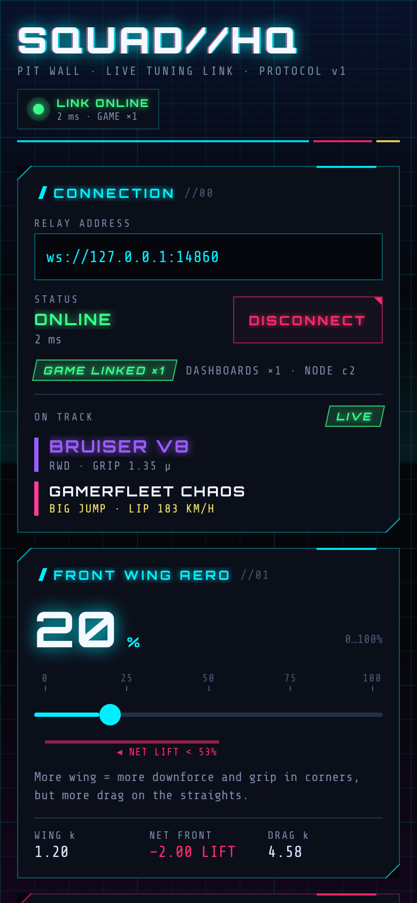

# SquadHQ dashboard (`dashboard/`)

SquadHQ is the squad's tuning console for the GamerFleet racer. It's a dark cyberpunk control panel built with
React Native and Expo (SDK 58). It has three sliders: **Front Wing Aero**, **Engine Tier** and **Chassis
Balance**. Every slider movement goes out live over WebSocket to the local relay (`server/`). The game
(`game/`) picks the values up and changes its car physics straight away, then sends back its applied physics,
the car and map you picked in its ☰ menu, and live race telemetry. Every preview, preset verdict and big-jump
verdict on this screen is worked out for that car on that map.

<p align="center">
  
</p>

Full-length phone view: [`docs/screenshot-full.png`](docs/screenshot-full.png) · tablet and desktop layout:
[`docs/screenshot-wide.png`](docs/screenshot-wide.png)

```
 phone: SquadHQ ──squad:controls (≤30 Hz)──▶ relay :8787 ──▶ racer (browser)
                ◀── game:state (physics, car, map) · game:telemetry (10 Hz) ──
```

## Run it on your phone (Expo Go)

You need Node 22+, the free **Expo Go** app (SDK 58) on the phone, and the phone and computer on the **same
Wi‑Fi**.

```bash
# from the repo root: relay + game + dashboard together
npm run dev:all

# …or just the pieces you need, each in its own terminal
cd server && npm install && npm start          # relay on ws://0.0.0.0:8787
cd dashboard && npm install && npx expo start  # Metro + QR code
```

1. Scan the QR code. On iOS use the Camera app, on Android use Expo Go. SquadHQ opens in Expo Go. No
   development build is needed, because every native module used here ships inside Expo Go.
2. The **Relay address** box is pre-filled with `ws://<IP of the computer running Metro>:8787`, and the app
   connects by itself. If the relay runs on a different machine, type the address that machine's relay prints
   at startup:
   ```
   Enter one of these in the SquadHQ dashboard (phone on the same Wi-Fi):
     ws://192.168.1.23:8787  (en0)
   ```
   A bare `192.168.1.23` or `192.168.1.23:8787` also works; it is normalized to `ws://…:8787`.
3. The header LED turns green with **LINK ONLINE**. Once the racer is open in a browser, the connection card
   shows **GAME LINKED ×1**, and **On track** shows the car and map picked in the game's ☰ menu. Switch either
   in the game and the dashboard follows within a fraction of a second.

The last address you connected to is saved. On the next launch the app reconnects to it automatically, unless
you pressed **Disconnect** last time.

## Web mode

```bash
npx expo start --web            # dev server; open http://localhost:8081
npm run export:web              # static build in dist/ (serve it with any static file server)
```

On the web, the default relay is `ws://<page hostname>:8787`. The sliders also work from the keyboard: focus
one with Tab, then use ←/→ or ↑/↓ for one step, PageUp/PageDown for a tenth of the range (one tier
on Engine Tier), and Home/End for min/max.

## What's on the screen

| Panel | What it shows |
| --- | --- |
| **Connection** | Relay URL, Connect/Disconnect, `CONNECTING` / `ONLINE` / `OFFLINE` / `RETRY IN Ns`, round-trip latency (ping every ~2 s), `GAME LINKED ×n` or `NO GAME LINKED`, count of other squad dashboards. **On track** shows the car (name in its garage colour, drivetrain, tyre grip) and the map (its big-jump lip speed, `NO BIG JUMP`, or `ICE · 55 % GRIP` on Cryo Drift), tagged `LIVE`, `LAST KNOWN` (the game dropped off the relay, so the last car and map it reported are kept) or `DEFAULT` (no game has reported yet: Neon Hypercar on GamerFleet Chaos). |
| **Front Wing Aero** 0–100 % | Front-wing downforce factor vs the car's body lift. The magenta zone is where the front nets **lift** at speed: below ~42 % on the Neon Hypercar, 32 % on the Glitch Rally, 53 % on the Bruiser V8, 13 % on the Razorwing and 40 % on the Dune Goblin. |
| **Engine Tier** T1–T5 | Drive torque, contact-patch drive force and mass for the current car. On the Neon Hypercar that is 700→3500 N·m on the rear axle and +60 kg per tier; the all-wheel-drive Glitch Rally and Dune Goblin show `AWD TORQUE`. |
| **Chassis Balance** −50…+50 | Front/rear weight split (`describeChassisBalance`) and spring split (`balanceToSuspensionStiffness`) for the current car. Has a centre notch at 0. |
| **Presets** | BALANCED 50/3/0 · MAX DOWNFORCE 100/2/−10 · TOP SPEED 0/5/+10 · JUMP ATTEMPT, plus RESET. JUMP ATTEMPT is set per car (see below). Each preset shows its big-jump verdict for the current car and map, or its estimated top speed on a map without a big jump. |
| **Big Jump Readiness** | `assessBigJump` for the current car and the map's lip speed: **READY** / **TOO SLOW** / **NOSE LIFT**, the estimated top speed vs what this car needs, the nose-lift speed, and a hint that matches the verdict (`src/squad/bigJump.ts`; for the Dune Goblin, which no setup gets to either jump, it says so and names its best). A map's lip speed is set for the Neon Hypercar, and most other cars need a little more (e.g. 183 km/h → 186 for the Bruiser V8, 188 for the Glitch Rally, 192 for the Razorwing). After the game reports `speedTrapKmh`, the card also shows the real lip speed against the lip speed that **lands** for this car on this map (measured in the game's sim, see below), e.g. `CLEARED +1.5` or `SHORT −2.5`. On a map without a big jump the card says **NO BIG JUMP**, still shows top speed and nose lift, and names the maps that have one. |
| **Tune Preview** | `mapSquadControlsToPhysics(controls, car)` applied to your sliders: top speed, nose-lift speed (`NEVER` when the wing beats body lift; warns if the nose lifts below top speed), front aero at 200 km/h, drag, torque, weight and springs. **Applied in game** shows what the racer reports in `game:state`, with a badge: `SYNCED` / `SYNCING` / `OVERRIDE` (physics:set on top) / `UNCONFIRMED` / `LAST KNOWN`. |
| **Race Telemetry** | Speed, throttle and brake bars, front and rear aero load (front turns magenta **LIFT** when negative), flashing **NOSE LIFT** warning, rear slip meter (**TYRE SMOKE** at ≥ 50 %), wheels down, checkpoint, falls, run timer, best lap. Shows `NO SIGNAL` if telemetry stops for 2.5 s and `NO GAME LINKED` with no game on the relay. |

### Cars, maps and the big jump

The game sends `carId`, `trackId` and `bigJumpKmh` in every `game:state`, and the relay keeps the latest
values in `snapshot.session` for a dashboard that connects later. The car picks the slider mapping and the
estimates (`CAR_CLASSES` in [`shared/protocol.ts`](../shared/protocol.ts)). The map's `bigJumpKmh` is the
lip speed its jump needs; `null` means the map has no big jump. A game from before the garage sends none of
these fields and is treated as the Neon Hypercar with a 183 km/h lip.

JUMP ATTEMPT per car, with the estimate on GamerFleet Chaos (183 km/h lip):

| Car | JUMP ATTEMPT | Est. top / needed | Verdict |
| --- | --- | --- | --- |
| Neon Hypercar | 20 % / T5 / −20 | 192 / 183 km/h | READY |
| Glitch Rally | 2 % / T5 / −40 | 189 / 188 km/h | READY |
| Bruiser V8 | 20 % / T5 / 0 | 186 / 186 km/h | READY |
| Razorwing | 14 % / T5 / 0 | 197 / 192 km/h | READY |
| Dune Goblin | 0 % / T5 / 0 | 133 / 183 km/h | TOO SLOW: no setup gets it there |

The Glitch Rally, Bruiser V8 and Razorwing setups are settings that cleared the chaos jump in test runs of
the game itself; the Neon Hypercar keeps its classic preset. The same setups are also READY on Cloudbreak Isles
(163 km/h: the estimate's number for its short 520 m run-up). The other maps (Neon Ribbon, Cryo Drift,
Midnight Strip, Proving Ground) have no big jump. The car colours, map names and landing speeds come from the
game's catalogs and are copied in `src/squad/garage.ts`; `test/garage.test.ts` fails if that copy drifts.

**Verdict rule** (`assessBigJump` in `shared/protocol.ts`, the same function the game uses). A car that is fast
enough (estimated top speed ≥ what it needs) is **NOSE LIFT** when its lift-off speed is below its top speed plus
a per-car reserve (12 km/h on the Neon Hypercar): the long run-up brings it to within a few km/h of top speed,
and with lift-off only just above that the nose is too light to steer through the run-up's kink. A car that is
too slow gets no reserve: **NOSE LIFT** only if it actually reaches its lift-off speed (lift-off below top speed),
otherwise **TOO SLOW**, so the hint never tells a slow car to add wing. For the Neon Hypercar the physics, the
slider mapping and every estimate (top speed, lift-off, needed speed) are unchanged from before the garage; only
the verdict for fast-enough setups changed. It used to say NOSE LIFT only when lift-off was below the 183 km/h
lip, but the game's sim lifted the nose and ran off the track at settings it called READY (e.g. 8 % / T5 / −40:
nose up at 192.3 km/h). Over all 51,005 slider positions, 590 (all Engine Tier 5) went READY → NOSE LIFT;
every other hypercar verdict is the same as before, e.g. 12 % / T4 / 0 is still TOO SLOW (top 175.5, lift-off 178.8).

**Speed trap: judged against the speed that lands.** The lip sign (`bigJumpKmh`) is the estimate's target,
not the speed that lands. Each map's landing lip speed was measured in the game's sim (standstill at the
jump's checkpoint, full throttle, sliders swept around each car's edge): it is the first 0.5 km/h step above
the fastest lip speed that fell, so every measured run at or above it landed. `CLEARED` / `SHORT` compare the
game's `speedTrapKmh` with that number (`src/squad/bigJump.ts → landingSpeedFor`):

| Map (lip sign) | Neon Hypercar | Glitch Rally | Bruiser V8 | Razorwing | Dune Goblin |
| --- | --- | --- | --- | --- | --- |
| GamerFleet Chaos (183) | 183.5 | 184 | 182 | 188.5 | can't reach it (≈ 129 at the lip) |
| Cloudbreak Isles (163) | 160.5 | 160.5 | 156.5 | 164.5 | can't reach it (≈ 125 at the lip) |

A car with no measurement (or an unknown car id) is judged against the Neon Hypercar's number and the card says
so; a map this build doesn't know, or a game reporting a different lip than the copy here, is judged against the
lip it reports. Just below a landing speed a jump can still land (the edge is a coin flip over 1–2 km/h, and
low-wing setups fly farther, landing up to ~3 km/h lower), so `SHORT −0.3` on a jump that landed means you got
away with it; `CLEARED` means every measured run at that speed landed.

Haptics: a tick on every Engine Tier step, a tick every 10 units on the other two sliders, a firmer bump when
Chassis Balance lands on 0, and a confirmation buzz on presets. Web has no haptics.

## Networking behaviour

All of this lives in `src/net/squadLink.ts`, `src/net/controlsThrottle.ts`, `src/squad/controller.ts` and
`src/squad/sync.ts`.

- **Role and hello.** The app connects to `ws://host:8787/?role=dashboard` and sends
  `hello {role:'dashboard', name:'SquadHQ <platform>'}` as soon as the socket opens. Every inbound frame goes
  through `parseMessage` from [`shared/protocol.ts`](../shared/protocol.ts).
- **What is sent.** `squad:controls` always carries **all three exact slider values**, snapped to
  `SQUAD_CONTROL_SPECS`.
  - **While dragging**, sends are throttled to one per `CONTROLS_SEND_INTERVAL_MS` (33 ms, about 30 frames/s).
    The newest value always goes out when the window ends: the trailing send is guaranteed.
  - **On release** (`onSlidingComplete`, or key-up on web), the final value is sent **immediately**.
  - **Presets and Reset** are sent immediately.
- **Sync rule on (re)connect.** The relay's `server:welcome` carries `snapshot.controls`.
  - If the snapshot has controls **and you haven't touched a slider, preset or reset since launch**, the app
    **adopts** them and sends nothing. You see the squad's current tune.
  - Otherwise it **pushes** its own three values. This covers an empty relay, or you tuning while the link
    was down.
- **Other dashboards.** An incoming `squad:controls` from another dashboard updates your sliders, **except
  a slider you are holding right now**. When you let go, your full set is broadcast.
- **Reconnects.**
  - Exponential backoff from 500 ms to 8 s, with ±25 % jitter.
  - A socket stuck connecting is dropped after 8 s.
  - An "open" socket that has received nothing (not even pongs) for 7 s is treated as dead. This catches
    half-open sockets after a Wi‑Fi hop.
  - Bringing the app back to the foreground retries straight away.
  - **Disconnect** stops all retries.
- **Re-renders.** Socket traffic lands in small external stores, not in root React state. Each panel
  subscribes to its own slice, so 10 Hz telemetry re-renders only the telemetry panel, and a slider drag
  re-renders only that card and the previews.

## Scripts

| Command | What it does |
| --- | --- |
| `npm start` | `expo start` (Metro + QR code for Expo Go) |
| `npm run web` | `expo start --web` |
| `npm run typecheck` | `tsc --noEmit` for the app and for `test/` |
| `npm test` | Unit tests (`node:test` via tsx): throttle timing, reconnect/backoff/stale detection, sync rules, car/map session from `game:state` and the snapshot, car-aware previews, per-car presets vs `assessBigJump`, garage copy vs the game's catalogs, URL parsing, haptic rules |
| `npm run export:web` / `npm run export:android` | Production bundles (proves Metro can bundle `../shared`) |
| `npm run doctor` | `expo-doctor` |

## Shared protocol

The app imports the wire protocol directly, with `import … from '../../../shared/protocol'`. Nothing is copied
or generated. To make that work:

- `metro.config.js` adds `../shared` to `watchFolders`, and pins module resolution to this app's
  `node_modules`.
- `tsconfig.json` includes `../shared/**/*.ts`.

The same file drives the slider ranges, the car classes, the physics preview and the big-jump verdict, so the
dashboard always agrees with the game and the relay.

## Troubleshooting

- **Stuck on `RETRY IN Ns` / "Could not reach the relay".**
  - Check the relay is running: `npm start` in `server/`.
  - Open `http://<computer-ip>:8787/health` in the **phone's browser**. If that times out, the problem is the
    network or a firewall, not the app.
  - Don't use `localhost` on a phone. There, `localhost` means the phone itself.
- **Firewall.**
  - macOS: allow incoming connections for `node`.
  - Windows: allow Node.js on *Private* networks, and set the Wi‑Fi profile to Private.
  - Linux: for example `sudo ufw allow 8787/tcp`.
- **Guest, office or hotel Wi‑Fi** often blocks device-to-device traffic (client isolation). A phone hotspot
  with the laptop joined to it works well. Pause VPNs on both devices.
- **iOS local network permission.** iOS 14+ asks before an app may talk to devices on your LAN.
  - In Expo Go, allow **Local Network** when prompted, or later in Settings → Privacy & Security → Local
    Network → Expo Go.
  - In a development or standalone build, the prompt text comes from `ios.infoPlist.NSLocalNetworkUsageDescription`
    in `app.json`. `NSAppTransportSecurity.NSAllowsLocalNetworking` permits plain `ws://` to LAN addresses.
- **Android cleartext `ws://` in dev builds.** Expo Go already allows it. Android 9+ blocks cleartext traffic
  in release-style builds. This project enables it through the `expo-build-properties` plugin in `app.json`
  (`android.usesCleartextTraffic: true`), so `npx expo run:android` and EAS builds can still reach
  `ws://192.168.x.x:8787`. Remove that setting if you ever ship against a `wss://` relay only.
- **`expo start --tunnel`** only tunnels Metro, not the relay. Use LAN mode, or expose port 8787 yourself and
  enter that `ws://` / `wss://` address.
- **Web build served over HTTPS.** Browsers block `ws://` from `https://` pages (mixed content). Serve the
  dashboard over `http://` on the LAN, or put the relay behind `wss://`.
- **Fonts look like a plain monospace.** Orbitron and Share Tech Mono load at startup. If they fail or take
  more than 4 s, the app falls back to the system monospace and keeps working.

## Layout

```
dashboard/
  index.ts                     registerRootComponent → src/App
  app.json                     name SquadHQ, slug squadhq, dark UI/splash, iOS local-network + ATS, Android cleartext
  metro.config.js              watchFolders += ../shared
  public/index.html            dark web shell (no white flash), slider focus ring
  src/
    App.tsx                    fonts, splash, saved link prefs, auto-connect, AppState → wake()
    theme.ts                   palette (#05060A / #0B0F1A / cyan / magenta / yellow / acid green), glow helper
    net/squadLink.ts           WebSocket client: hello, ping/latency, backoff + jitter, stale detection
    net/controlsThrottle.ts    leading + guaranteed-trailing throttle, flush/force
    net/serverUrl.ts           default relay URL (Metro hostUri / page host), input validation
    squad/controller.ts        stores + every protocol decision (sync rule, remote merge, game state, car/map session)
    squad/sync.ts              pure adopt/push rule and mid-drag merge
    squad/session.ts           car/map session merge rules + previewSetup (car-aware physics, estimates, jump verdict)
    squad/garage.ts            car colours and map names/lips copied from the game's catalogs
    squad/presets.ts           the four presets (JUMP ATTEMPT per car)
    state/store.ts             tiny external store + useStore (useSyncExternalStore)
    features/                  ConnectionCard, SessionInfo (On track block), ControlSliderCard, PresetsCard, BigJumpCard, TunePreviewCard, TelemetryPanel
    ui/                        Panel (notched corners), Header (glitch title + LED), Background (grid + scan beam), Meter, Badge, NeonButton, Txt
  test/                        node:test suites (npm test)
  docs/                        screenshots
```
